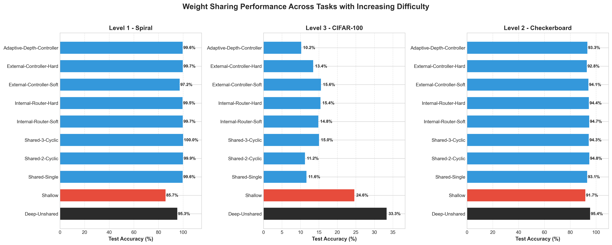
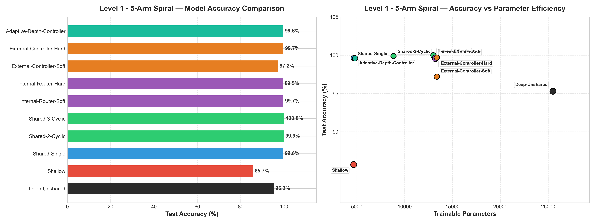
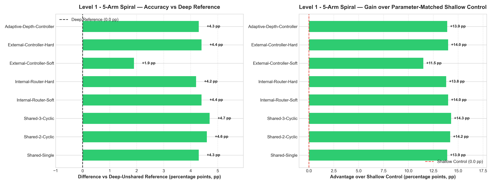
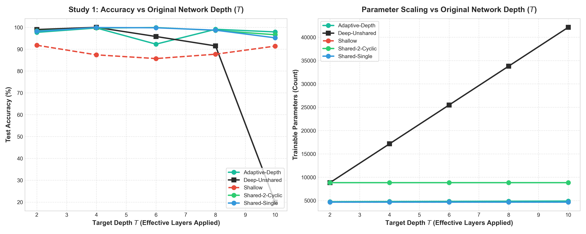
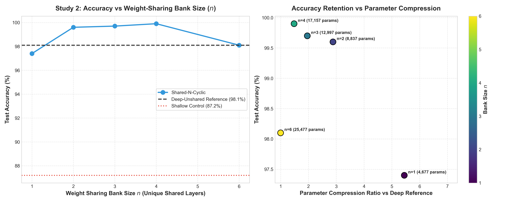

# Weight Sharing & Dynamic Layer Routing in Deep Neural Networks

An empirical research suite investigating depth-wise weight sharing (parameter reuse through cyclic layer execution) and learned routing mechanisms (internal state routers, external plan controllers, and adaptive halting controllers) in PyTorch.

[](https://pytorch.org/)
[](LICENSE)
[](https://developer.nvidia.com/cuda-zone)

---

## Overview

Can an unshared deep neural network of depth $T$ be replaced by a compact architecture that iteratively reuses a small bank of $n \ll T$ layers? And can a learned routing mechanism (soft mixture or hard selection) outperform deterministic cyclic scheduling?

This repository provides the complete experimental suite, evaluation protocols, and publication-ready visualization tools across three progressive difficulty tiers:

1. **Level 1 — 5-Arm Spiral Classification:** Non-convex geometric depth separation ($C=5$ classes, 2D input).
2. **Level 2 — $4 \times 4$ Checkerboard Classification:** Combinatorial parity separation with 3% label noise ($C=2$ classes, 2D input).
3. **Level 3 — CIFAR-100 Vision Benchmark:** Real-world fine-grained hierarchical visual categorization ($C=100$ classes).

Additionally, this project implements two systematic parameter-scaling studies:
- **Study 1 (Depth Scaling):** Accuracy and optimization stability vs. target depth $T \in [2, 10]$.
- **Study 2 (Bank Size Scaling):** Accuracy retention vs. shared layer bank size $n \in [1, 6]$.

---

## Key Experimental Findings

For the complete methodological analysis, parameter accounting, and discussion of caveats, see **[REPORT.md](REPORT.md)**.

- **Depth-via-Reuse on 2D Geometries:** On the 5-Arm Spiral, `Shared-Single` ($n=1, T=6$) matches the exact parameter count ($4,677$ params) of the `Shallow` control while outperforming it by **$+13.90$ percentage points (pp)** ($99.60\%$ vs. $85.70\%$).
- **Regularization at Extreme Depths:** In Study 1 ($T \in [2, 10]$), `Deep-Unshared` catastrophically collapses at $T=10$ to **20.00%** (random guess on 5 classes) due to vanishing/exploding gradients. Weight-shared models remain stable across all depths ($95.20\%$ to $97.90\%$ at $T=10$).
- **The $n=2$ "Elbow Point":** In Study 2 ($n \in [1, 6]$), transitioning from $n=1$ to $n=2$ delivers the steepest accuracy gain ($+2.20$ pp) to achieve $99.60\%$ accuracy at $2.88\times$ parameter compression. Beyond $n=2$, accuracy plateaus.
- **Learned Routers vs. Cyclic Reuse:** Dynamic internal routers and external plan controllers introduce additional parameter overhead without delivering consistent gains over fixed cyclic reuse (`Shared-3-Cyclic`).
- **Domain Limits on Natural Images:** The weight-sharing hypothesis **fails on CIFAR-100**. All weight-shared models score between $10.22\%$ and $15.56\%$, trailing the unshared deep reference ($33.32\%$) and the parameter-matched shallow baseline ($24.58\%$). Applying identical convolutional filters repeatedly across depths degrades multi-scale feature hierarchies.

---

## Cross-Task Benchmark Summary



### Summary Table ($T=6$)

| Model Variant | Mechanism | L1 Spiral (5-class) | L2 Checkerboard (2-class) | L3 CIFAR-100 (100-class) | Compression vs. Deep |
| :--- | :--- | :---: | :---: | :---: | :---: |
| **`Deep-Unshared`** | Unshared Reference | 95.30% | **95.40%** | **33.32%** | $1.00\times$ |
| **`Shallow`** | Control Baseline | 85.70% | 91.70% | 24.58% | $5.34\times$ – $5.64\times$ |
| **`Shared-Single`** | Static Reuse ($n=1$) | 99.60% | 93.10% | 11.63% | $5.34\times$ – $5.64\times$ |
| **`Shared-2-Cyclic`** | Static Reuse ($n=2$) | 99.90% | 94.80% | 11.23% | $2.86\times$ – $2.93\times$ |
| **`Shared-3-Cyclic`** | Static Reuse ($n=3$) | **100.00%** | 94.30% | 15.01% | $1.95\times$ – $1.97\times$ |
| **`Internal-Router-Soft`** | Dynamic Mixture ($n=3$) | 99.70% | 94.70% | 14.84% | $1.93\times$ – $1.95\times$ |
| **`Internal-Router-Hard`** | Discrete Choice ($n=3$) | 99.50% | 94.40% | 15.42% | $1.93\times$ – $1.95\times$ |
| **`External-Controller-Soft`** | Soft Plan ($n=3$) | 97.20% | 94.10% | **15.56%** | $1.77\times$ – $1.92\times$ |
| **`External-Controller-Hard`** | Discrete Plan ($n=3$) | 99.70% | 92.80% | 13.44% | $1.77\times$ – $1.92\times$ |
| **`Adaptive-Depth-Controller`** | Dynamic Halting ($n=1$) | 99.60% | 93.30% | 10.22% | $4.22\times$ – $5.46\times$ |

---

## Repository Structure

```
├── models.py            # PyTorch implementations of all 10 architectures (MLP & Conv)
├── datasets.py          # Data generators (Spiral, Checkerboard) & Fast GPU CIFAR-100 engine
├── experiments.py       # Benchmark runners, training loops, evaluation, & logging
├── plot_results.py      # Publication-quality plotting and visualization routines
├── main.py              # CLI master runner entrypoint
├── REPORT.md            # Comprehensive research report documenting experiments & caveats
├── requirements.txt     # Python environment dependencies
├── .gitignore           # Git ignore file (excludes caches, data archives, logs)
└── results/             # Generated CSV tables, Markdown summaries, and PNG figures
    ├── benchmark_level_1_-_5-arm_spiral.png
    ├── benchmark_level_2_-_4x4_checkerboard.png
    ├── benchmark_level_3_-_cifar-100.png
    ├── baseline_contrasts_level_1_-_5-arm_spiral.png
    ├── baseline_contrasts_level_2_-_4x4_checkerboard.png
    ├── baseline_contrasts_level_3_-_cifar-100.png
    ├── cross_task_benchmarks_summary.png
    ├── study_original_network_size_depth.png
    ├── study_weight_sharing_size_bank.png
    ├── training_dynamics_*.png
    └── *.csv / *.md
```

---

## Installation & Setup

### Prerequisites
- Python 3.10+
- PyTorch with CUDA support (recommended) or CPU

### Installation
Clone this repository and install dependencies:
```bash
git clone https://github.com/your-username/weight-sharing-neural-networks.git
cd weight-sharing-neural-networks
pip install -r requirements.txt
```

---

## Usage

The suite is orchestrated via `main.py` with flexible CLI flags:

### 1. Run All Benchmarks and Studies
```bash
python main.py --suite all
```

### 2. Run Only Synthetic Benchmarks & Scaling Studies
```bash
python main.py --suite synthetic --synthetic-epochs 300
```

### 3. Run Only Size Studies (Depth Scaling & Bank Scaling)
```bash
python main.py --suite studies
```

### 4. Run Only CIFAR-100 Vision Benchmark
```bash
python main.py --suite cifar --cifar-epochs 12
```

### 5. Regenerate Figures from Existing Results
To regenerate all publication figures directly from logged CSV files without re-training:
```bash
python plot_results.py
```

---

## Visualizations

### Level 1: 5-Arm Spiral Benchmark & Baseline Contrasts
| Accuracy & Pareto Frontier | Baseline Contrasts (Percentage Points) |
| :---: | :---: |
|  |  |

### Parameter Scaling Studies (Spiral)
| Study 1: Target Depth ($T \in [2, 10]$) | Study 2: Bank Size ($n \in [1, 6]$) |
| :---: | :---: |
|  |  |

---

## Citation & Documentation

For detailed analysis, mathematical formulas, and scientific discussion, refer to **[REPORT.md](REPORT.md)**.
